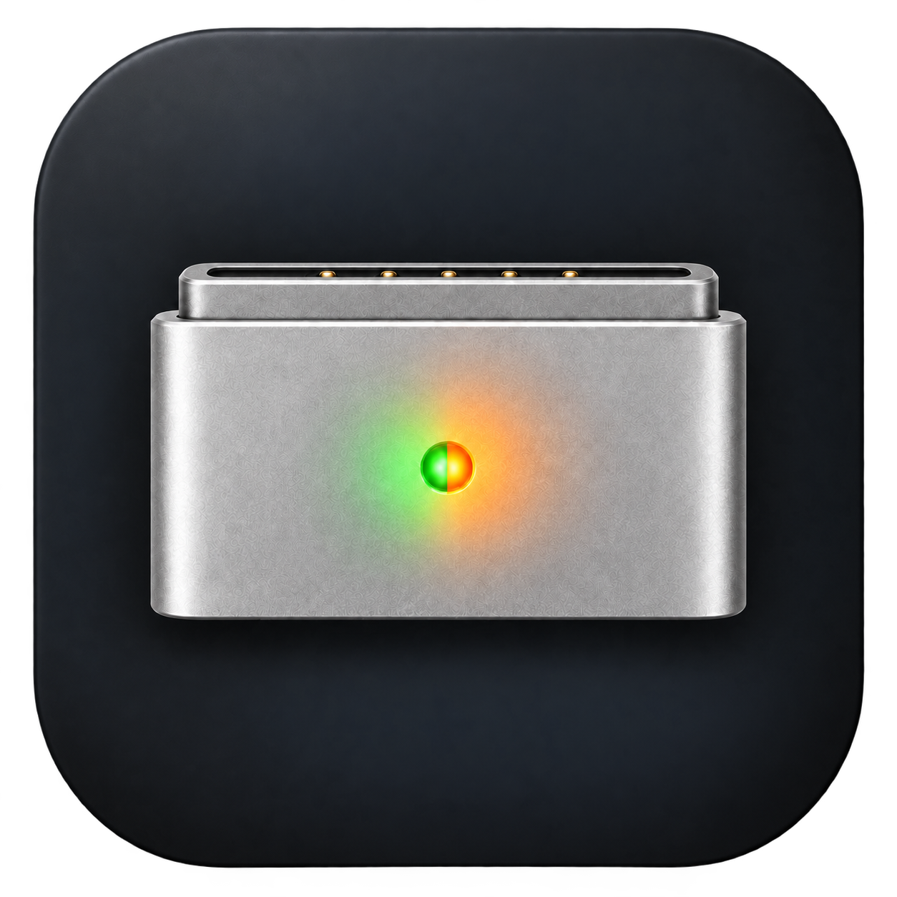

<p align="center"></p>

# MagDot

A small native macOS menu-bar app that uses the official MagSafe 3 connector LED for local T3 Code activity. Apple Silicon, macOS 14 or later. GPL-3.0-only.

MagDot currently works exclusively with **T3 Code agents**. Contributions are welcome—help add integrations with other agents. See [Contributing](CONTRIBUTING.md).

## Controls

- **Activate:** a single on/off switch in the menu and General settings. MagDot activates automatically when opened with MagSafe connected.
- **Deactivate:** restore macOS LED control and close the session.
- **Quit:** wait for restoration acknowledgement before exiting.

A missing/unreadable T3 database produces idle, not a simulated activity pattern.

| State | LED | Duration |
|---|---|---|
| Working | Green 1 s / amber 1 s | While a recent turn is running |
| Finished | Green ~0.67 s / off ~1 s | Forever by default; optional timer, or acknowledgement in the foreground T3 chat |
| Needs input | Amber 1 s / off 1.5 s | While a matching unresolved request exists |
| Idle | macOS controls the LED | Until new activity |

Attention takes priority over finished, which takes priority over working. Colors switch discretely; brightness dimming is not supported by this implementation.

## Installation and privilege model

The app bundles a native controller and SQLite reader. Python and a source checkout are not runtime dependencies.

A release needs Developer ID signing and Apple notarization before the `SMAppService` launch daemon can be installed normally. First launch registers the bundled helper and may require one-time approval in **System Settings → General → Login Items & Extensions**. Once approved, Start/Stop/Quit use local IPC without `osascript` or repeated administrator prompts.

The root helper is socket-activated: macOS starts it when MagDot connects, and it exits after the LED session is restored. It has no KeepAlive job and does not stay running after Quit. It accepts only the MagDot app identifier signed by the same Apple signing team as the helper; the peer is identified using its kernel audit token. No sudoers rules, SIP changes, charging limits, or network services are used.

Quit the app before upgrading, unregistering, or disabling its helper in System Settings. A changed helper may require unregistering and registering again, as required by Service Management. To remove the registered helper before deleting the app:

```sh
/Applications/MagDot.app/Contents/MacOS/MagDot --unregister-helper
```

## Build locally

Requires Xcode command-line tools. `SIGN_IDENTITY` is a signing identity name from your own Keychain, not a secret.

```sh
SIGN_IDENTITY='Developer ID Application: Your Name (TEAMID)' scripts/build-app.sh
open build/MagDot.app
```

Without `SIGN_IDENTITY`, the script uses ad-hoc signing for compilation checks only; this does not enable the privileged service. Build output targets Apple Silicon/macOS 14+. The transparent PNG artwork is packaged into the app icon. Do not move a registered app bundle while its helper is installed.

The independent controller remains available for explicitly authorized hardware tests:

```sh
make
build/magdot read
sudo build/magdot demo 20
sudo build/magdot working 20
sudo build/magdot finished 20
sudo build/magdot attention 20
sudo build/magdot idle
```

Do not run manual LED commands while the app has an active session. All controllers share an exclusive lock.

## T3 integration

The app opens `~/.t3/userdata/statev2.sqlite` read-only and reads only lifecycle metadata from the v2 projections: turn IDs, status/timestamps, thread archive/delete state, `lastVisitedAt`, and request kind/status. It does not query message or request bodies, tokens, or credentials.

This is an internal-schema adapter, not a supported T3 public API. A running turn expires after one hour; there is no arbitrary one-hour app-session limit. Old completions are suppressed on startup. Cancellation/failure clears that turn; other threads may still determine the LED state. Schema/read errors temporarily return control to macOS without discarding pending completions. Visit dismissal depends on T3 recording `lastVisitedAt`, T3 being the foreground app, and the lid being open; individual window visibility is not detected. The `user_input` kind was observed in the live database; approval/permission filters are provisional until observed against a real pending approval.

## Restoration and limits

Only SMC key **ACLC** is read/written, using values 0, 1, 3, and 4. Restoration seeds the full/not-full battery color, waits 300 ms, then releases to system mode. Firmware may subsequently report green/amber rather than literal zero.

Each session has a separate watchdog. App disconnect, a four-second heartbeat expiry, explicit Stop/Quit, and controller termination end the session and attempt restoration. Signals are unblocked explicitly. AppKit deferred Quit uses an off-run-loop socket handshake. Sleep stops the active session; tracking resumes on wake with pending completions retained.

Stop other LED-control utilities first. Unexpected readback stops the controller; identical competing writes cannot be identified. Restoration may supersede a competing controller. SMC failures stop writes; MagSafe reconnection starts a new session. No software can guarantee restoration after killing both controller and watchdog, a kernel failure, or power loss.

## Verification

```sh
build/MagDot.app/Contents/MacOS/MagDot --self-test
build/MagDot.app/Contents/MacOS/MagDot --probe-t3
SIGN_IDENTITY='Developer ID Application: Your Name (TEAMID)' scripts/test-service.sh
```

The service test builds a **compile-time fake SMC** and uses an isolated temporary socket, with real code-signature checks. Production binaries have no fake-hardware or alternate-socket environment switch. It covers unsigned-client rejection, repeated Start/Stop, active Quit, and app crash recovery without authentication or LED writes.

`tests/hardware.py` is an opt-in administrator test that really writes the LED via the controller. Do not run it during an active app session.

Protocol sources: [MagHue](https://github.com/kamenlevi/MagHue/blob/main/Sources/MagHueCore/SMC.swift) and [JuiceLeft](https://github.com/Weta-Technologies/JuiceLeft/blob/main/juiceleft-led.c). MagDot uses GPL-3.0-only.

## Sequence settings

Open **Settings…** in the menu bar . The sidebar contains General, States, Experimental, and About. States shows Working, Done, and Input together, each with its default sequence and adjustable speed. Working alternates green/amber, Done blinks green/off, and Input blinks amber/off. The hardware does not provide a verified red mode.

Lit phases range from 1.6 to 0.4 seconds. Working and Input show 1× at 1 second; Done shows 1× at approximately 0.67 seconds. Blinking presets include an off pause 1.5 times the lit phase. Changes save automatically in local preferences and are applied on subsequent helper heartbeats; Restore Default affects only its own state. Idle and missing T3 data always use system behavior; Stop/Quit always restore system control.


The play/pause control previews one state on the connector until paused, Settings is closed, or MagDot is stopped. Starting another preview replaces the current one. Pausing resumes T3 tracking, or restores system control if MagDot was stopped before the preview.

Done duration: 1, 3, 5, 10, or 20 minutes, or Forever (default). A completed chat is acknowledged only when T3 is the foreground app, the laptop lid is known to be open, and T3 marks the chat visited. Background or closed-lid visit updates do not dismiss Done. Starting a new turn in that chat clears its previous completion. This is app-level focus detection, not per-window visibility detection across desktops. The timer starts at completion, including while another thread has priority. Pending completions survive sleep and tracking resumes on wake; finite timers continue to count elapsed time during sleep. Forever lasts within the current tracking session; restarting MagDot clears pending completions. Done’s default 1× is approximately 0.67 seconds green and 1 second off. Input takes priority over Done, then Working, then system control.

About includes signed in-app updates with separate download and restart confirmation. Switch MagDot off before installing an update. A published GitHub release with the signed appcast and ZIP is required; no release has been published as part of local development.

General includes Launch at login (on by default) and Hide from Dock (on by default). Helper approval is followed automatically by connection; no second activation is needed.

Icon builds retain the original PNG artwork and all ICNS resolutions. Larger representations use macOS JPEG 2000 compression (quality 45) to reduce bundle size; small representations stay unchanged. This is lossy encoding, with no additional build dependency.

### MagSafe connection watcher

MagDot reads the MagSafe port's `ConnectionActive` IORegistry property (`PortType = 17`), independently of battery charging or USB-C power. While disconnected it stops T3 polling and releases the LED session; a lightweight, read-only watcher remains in the app and checks once per second. Reconnection automatically starts a fresh helper session and retains pending tracked completions. Manual Stop remains off across reconnects until manual Start or app relaunch. Quit exits the watcher too; open MagDot again (or enable Launch at login) to restore automatic detection.

General → **Hide menu bar icon when unplugged** defaults to on. Open MagDot from Applications/Spotlight to access Settings while its icon is hidden. Turning this setting off keeps the icon visible without activating LED control. An unknown/unsupported connection state stops LED control but keeps the icon accessible. These private IORegistry properties are verified on the development Mac; other Mac models need hardware validation.

See [Licenses & Acknowledgements](ACKNOWLEDGEMENTS.md) for third-party components.


### Double-tap MagSafe

Off by default. Enabling asks macOS for **Input Monitoring** using IOKit's access
request API. The permission row shows **Allowed** once access is granted; after a
previous denial, Allow opens the relevant System Settings pane. The enabled choice is flushed to disk before the permission request. Some permission
changes require quitting and reopening MagDot; that relaunch retains the choice. This feature matches only the
accelerometer service; it does not register keyboard or microphone callbacks.

With access allowed and MagSafe connected, opening Double-tap MagSafe starts the live MacBook preview
automatically, including when the feature is off. Rings show estimated regions;
orange means uncertain, and stronger impacts draw larger rings. Settings previews show gestures and can navigate when an agent is eligible. Outside setup, the enabled feature
keeps the sensor ready while enabled with an open lid. It navigates only while
an agent is Done or needs input, and rechecks the target at gesture
confirmation. It opens `t3code://threads/<environment>/<thread>`, prioritizing
unresolved input over the most recent observed, unacknowledged completion.
No Accessibility or Automation permission is used for navigation.

**Use default profile** is on initially. With it on, the provided model is used
and **Sensitivity** tunes tap detection. Turning it off opens personal calibration.
Tap the highlighted MagSafe connector or corner freely, at your own pace and
with varied strength. Setup moves through MagSafe, top-right, bottom-left, and
bottom-right only. There is no requirement to tap in pairs, pause after a pair,
or perform keyboard/trackpad/handling exercises.

Calibration continuously records short sensor windows, including the vibrations
between taps. Each window stores raw accelerometer frames, grouped impacts, and
an aggregate input activity flag. Single taps and freely timed runs of taps all
count. The model learns short local tap signatures; runtime still combines fresh
impacts into a double-tap. High-confidence decay vibrations are saved as negative
examples, using a short stable-waveform prediction and energy decay test. Uncertain
rejections are not automatically labeled as vibration. Incidental input-active
windows become background negatives and never count as positive captures. No key
contents, touch paths, or pointer coordinates are recorded.

Every fourth accepted window is reserved for the existing automatic check and
does not train the model. Orange circles animate during assessment. At least
two-thirds of held-out MagSafe impacts must be recognized; held-out corner taps
and captured decay vibrations must not activate it. Inconclusive locations collect
more examples and new reserved windows. All dots turn green after the checks pass
and the profile is saved. This remains a correlated within-session check, without
a separate user validation exercise or a cross-environment accuracy guarantee.

New profiles use the continuous free-tap format (version 2). Earlier single-tap
and complete-pair profiles remain saved and readable. Settings offers free-tap
recalibration without deleting the active profile. Interrupted attempts do not
overwrite a successful profile.

Raw candidates pass an impact grouper before pairing. Decay stays with its tap;
a fresh second attack can still pass after 90 ms. A stable short waveform
prediction helps distinguish a weaker second tap from continuing vibration. The
raw candidate interval is short enough that a ringing candidate does not consume
the previous 85-ms interval and hide the second tap. A one-tap runtime window stays
open for the full pairing interval. Tap Lab retains its existing raw candidate
interval and publishing workflow.

The connector is drawn partly behind the chassis when connected. While MagSafe is disconnected, the settings controls are dimmed and disabled, and sensing pauses; the title, subtitle, and keyboard illustration retain their normal appearance. Outside calibration, recognized MagSafe impacts produce green rings.

Default and legacy profiles still use a clear MagSafe anchor with an uncertain neighbor only when it is closer to MagSafe than the learned corners. Version-1 complete-gesture profiles classify the pair as a whole; version-2 profiles classify local taps and pair fresh impacts at runtime. A closer stored negative example vetoes a positive custom classification. Sensitivity changes onset detection and the positive location-confidence range, with a wider range for gentle taps and a lower detection floor derived from the personal profile; quiet samples update the noise baseline so startup movement cannot permanently raise the threshold. These are rejection safeguards, not a guarantee of location accuracy. Done-chat candidates come from T3's unread latest completed runs rather than the LED expiry tracker. Successful handoffs advance an in-memory queue, with a later completion in that thread eligible again.

Recent keyboard events and pointer movement, clicks, drags and scrolling suppress
taps for 750 ms and clear pending pairs. This includes normal trackpad interaction
and external mice. Plain contact is also monitored through the dynamically loaded private
MultitouchSupport framework, using contact presence and release state only. No
positions, key codes, event contents or touch paths are stored. It starts only
alongside the permitted sensor, stops with it, and reports available devices and
received frame counts in local diagnostics. This is undocumented and must be
capability-tested per macOS/hardware version; no universal touch-blocking claim is
made. API declarations: https://github.com/lauschue/Remotastic/blob/main/MultitouchSupport.h
Incidental input-active windows during calibration may be saved as background negatives; they never navigate. No additional Accessibility permission is requested. Personal examples live in `Application Support/MagDot/PersonalCalibration`.

The default model remains available independently.
The first bundled dataset covers **Mac16,12 only**, using the previous frozen
Desk/Lap features; it is not a validated universal MacBook model. Unsupported
hardware shows that the gesture model is unavailable. Model identity is automatic;
users do not select size or supporting surface. The older `gesture.pretrained` preference remains ignored. The new default/custom
selection persists under `gesture.useDefault`.
Dataset collection continues separately in Tap Lab. Its connector single-tap
collector shows positive/negative counts and independent Test results. Publishing
with **Use this model in MagDot** writes a validated, hardware-specific connector
model under `~/Library/Application Support/MagDot/Models/`. MagDot reloads that
model automatically, keeps the bundled model as its initial fallback, and
suppresses navigation while Tap Lab is frontmost. The runtime gesture remains
a double-tap. Single taps train the default/legacy model; new personal profiles collect continuous free-tap recordings with between-tap vibration.

The preview starts an uncertain pulse immediately when an onset is detected,
without waiting for the 140-ms classification window. The same pulse receives
its area/color and peak-strength update when classification completes, retaining
its original animation time. Animation uses a 60-Hz common-mode timer; text status
updates remain throttled to 10 Hz. Training statistics and class radii are cached
once, avoiding repeated leave-one-out calculations on the UI thread per impact.

Fresh physical positive, negative and typing validation is still required;
precision varies with support, environment and tapping style. Missing sensor or
permission, closed/unknown lid, sleep and locked sessions stop sensing. Automated
`--self-test` covers defaults, cross-process preference persistence,
permission/lid/lifecycle policy, pair matching, rapid onsets, sensitivity,
immediate visual-onset delivery and cached/reference classifier parity.
Native helper IPC regressions remain separate.


Experimental Settings uses a scrollable profile section. Default/custom controls
and their Sensitivity slider share one divided box. A missing custom profile shows
the red default-profile notice. Calibration hints use short location names; the
intro fades away. Only the active calibration target pulses, grows and fills with
sample progress. The diagram reuses the menu-bar connector artwork and colors it
by physical MagSafe connection state. The default model remains the fallback until
a custom profile is successfully assessed.

While the Double-tap MagSafe tab is visible, a bounded local diagnostic file (`Application Support/MagDot/gesture-recent.json`) retains the latest six input-free sensor episodes with classification evidence. Typing does not overwrite these test recordings. Navigation diagnostics include an event timestamp so an earlier successful handoff cannot be mistaken for the latest tap. These diagnostics do not label the physical location; the tester supplies that label.

Version-2 personal profiles preserve signed initial motion and fit balanced, regularized feature weights. Existing reserved recordings protect against per-profile regression, with automatic legacy fallback. Saved raw recordings are reused without recalibration. See [the algorithm audit](docs/gesture-algorithm-audit.md) for recorded replay results, limitations, and the reproducible benchmark.

## Local worktree build

Use `SIGN_IDENTITY='<Developer ID identity>' bash scripts/run-worktree.sh` for local development. The canonical bundle is `build/MagDot.app` in this checkout. The command stops running MagDot app instances before rebuilding, refuses to interrupt calibration, increments a local build number, and embeds the source worktree and source digest in the signed bundle. `--build-only` builds without stopping or launching apps. `build/worktree-build.json` identifies the exact local output. Local build numbers do not change the release `BUILD_NUMBER` file.

Disconnect and reconnect reset the gesture stream and any failed-start latch. Enabled LED activation retries transient helper failures after a short delay and retains pending agent states; an explicit manual Stop stays stopped. Local `runtime-status.json` and `gesture-status.json` report the running app path, build and source digest.

The sensitivity slider changes both the impact detection threshold and the MagSafe location-confidence range. The adaptive noise floor and learned detection floor still apply; calibration uses a fixed capture sensitivity. Navigation requires a fresh Done/Input target even in Settings, while eligible tap visualization remains available without one. New calibration uses the centers of the left and right palm rests instead of the lower corners; `targetLayout=palm-rests-v1` distinguishes these recordings while retaining legacy location keys for backward compatibility. The pace badge is centered over the keyboard.

Manually marking a completed T3 chat unread now activates the Done light using the same unread-run eligibility as navigation. The configured Done duration starts when MagDot observes that unread episode; reading and re-marking it rearms the light. Input retains priority. The impact threshold and derived personal detection floor are halved. A later update also connects sensitivity to location confidence; pair timing remains unchanged.

Location sensitivity uses bounded positive-score, positive-margin and template-radius adjustments. The strong-negative cutoff and nearest-negative veto do not relax. Version-2 personal profiles cap unsafe expansion using their saved reserved corner/decay recordings. Calibration validation remains at the midpoint operating setting, and no new capture or setup steps are introduced. Diagnostics report `locationSensitivity` and `locationSensitivityLimit`. These checks are finite saved samples, not a general false-trigger guarantee.
